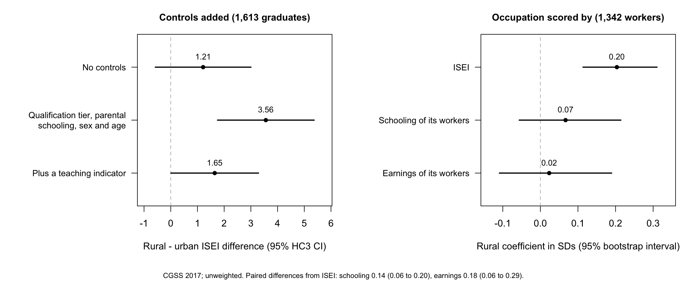

# Rural Origin, Teaching and Occupational Status among Graduates in China

Minghao Yang<br>
MA (Hons) Sociology, University of Edinburgh

Among Chinese graduates with similar qualifications and family background, those of rural origin hold jobs that score higher on ISEI, an international index that ranks occupations using the education and earnings of the people in them. Their reported earnings show no such advantage. I trace much of the difference to teaching: rural graduates more often teach, mostly in primary and secondary schools, and the index scores teaching highly. The advantage is much smaller when the same jobs are ranked by the schooling or earnings of the Chinese workers who hold them.

My paper, *Rural Origin, Occupational Status and Labour Income among Graduates in China*, uses the sample and models in this repository. The [results guide](docs/results-guide.md) links each result to its script and saved output.

## Findings

In CGSS 2017, 13% of rural-origin respondents aged 25 to 60 completed their highest reported qualification at junior-college level or above. For urban-origin respondents the figure is 46.5%. Among 1,613 graduates with a current or previous occupation outside farming, does rural origin predict lower occupational status?

I expected it would. After adjusting for qualification tier, parental schooling, sex and age, rural graduates score 3.56 points higher on the ISEI occupational status scale (95% CI 1.8 to 5.4), about 0.2 standard deviations. The unadjusted gap is only 1.21 points. Adjustment raises the estimate in part because rural graduates hold lower qualifications and come from families with less schooling. I decompose this 2.35-point change following Gelbach (2016). The qualification tier accounts for roughly 42%.

Teaching is reported by 17.8% of rural-origin and 10.2% of urban-origin graduates, with an adjusted difference of 8.9 percentage points. Adding a teaching indicator lowers the rural coefficient from 3.56 to 1.65. Among current workers with positive income and a known employer sector, the adjusted gap favouring rural graduates is 6.1 ISEI points in the public sector. Outside the public sector the estimates are smaller and both intervals include zero. But within public-sector teaching the gap is −0.06 points (CI −1.95 to 1.83). The public-sector gap may have more to do with which jobs rural graduates enter than with a score difference among teachers.

Among 1,347 current workers with positive 2016 labour income, rural origin predicts slightly lower log income. The unweighted interval excludes zero, but with survey weights or province clustering it widens to include zero. Adjusting for occupation and employer on the same workers reduces the rural ISEI coefficient from 3.46 to 0.30, partly by construction, since ISEI is assigned from the occupation code. The income coefficient scarcely moves (−0.103 to −0.106). I see higher occupational scores without an accompanying earnings advantage.

ISEI is built from international data. When I score each occupation group instead by the schooling or earnings of the CGSS workers in it, the rural coefficient is 0.07 standard deviations for schooling and 0.02 for earnings, against 0.20 under ISEI on the same 1,342 workers. The differences narrow when ISEI is averaged over the same groups, but their bootstrap intervals stay above zero. Rural graduates appear better placed on the international index than on either score built from Chinese workers.



## About this project

This started as my undergraduate dissertation at Edinburgh on education tiers, rural origin and birth cohorts. The occupation decomposition, the sector analysis, the adjustment supplement, and the analyses of teaching, income and occupational scores were developed after submission.

Teaching is where I want to look next. Rural graduates are more likely to hold teaching jobs, which score highly on ISEI, and I want to know how they entered those jobs when so few rural-origin respondents in the wider sample had completed higher education.

## Methods

The analysis uses the 2017 Chinese General Social Survey (N = 12,582). The analytical sample is 1,613 respondents who completed their highest reported qualification at junior-college level or above and reported a current or previous occupation outside farming. Rural origin means village or township registration at age 14 (A27H). It describes where the hukou was registered, not whether it was agricultural or non-agricultural.

The main specification is unweighted OLS with HC3 standard errors. I check against survey weights, province fixed effects and standard errors clustered across 28 interview provinces. Uncertainty in the adjustment decomposition comes from a province cluster bootstrap (1,999 draws). Teaching occupation is modelled with linear probability models. The sector models use interaction terms to separate the rural coefficient within each sector.

The main analysis uses syntax ISEI, which follows Ganzeboom's SPSS syntax modules. His earlier overview table and SIOPS provide alternative scores. The occupation allocation varies the reference score to examine how much of the fitted gap is assigned to teaching. The schooling and earnings scores are group means among CGSS workers aged 25 to 60, estimated in five folds so that no worker's own answer enters their score. Five of the 1,347 positive-income workers are in the armed forces and cannot be scored, leaving 1,342 ([details](docs/results-guide.md#occupational-profiles)).

## Limitations and next steps

The data are one cross-section, so age, cohort and career stage cannot be separated. Selection into higher education could contribute to the positive rural coefficient, including selection on earlier attainment that these models do not measure. CGSS records the year and broad type of the highest qualification but not a complete qualification history or the timing of entry into teaching.

Possible routes include teacher training programmes that targeted rural students, recruitment through public exams, and qualifying while already in a post. The [discussion](docs/discussion.md) sets out what a study using linked records at county level would need.

## Reading the project

The [research note](docs/research-note.md) presents the earlier analyses of occupational status, teaching and income. The [adjustment supplement](docs/origin-adjustment.md) explains why controlling for education and family background raises rather than lowers the rural coefficient. The [occupation allocation](docs/occupation-decomposition.md) shows how much of the rural coefficient is assigned to teaching at different reference scores. [Further results](docs/sensitivity.md) and [measurement notes](docs/measurement.md) cover the remaining tables and variable definitions. [Reproducibility](docs/reproducibility.md) describes how to run the analysis.

## Running the code

R 4.4.3 with package versions in [renv.lock](renv.lock). The CGSS 2017 data are not distributed here; see [data/raw](data/raw/README.md).

The commands below restore the packages and rebuild every output. [Reproducibility](docs/reproducibility.md) lists the scripts one by one.

```sh
Rscript --vanilla -e 'source("renv/activate.R"); renv::restore(prompt = FALSE)'
Rscript --vanilla R/run_all.R
```
