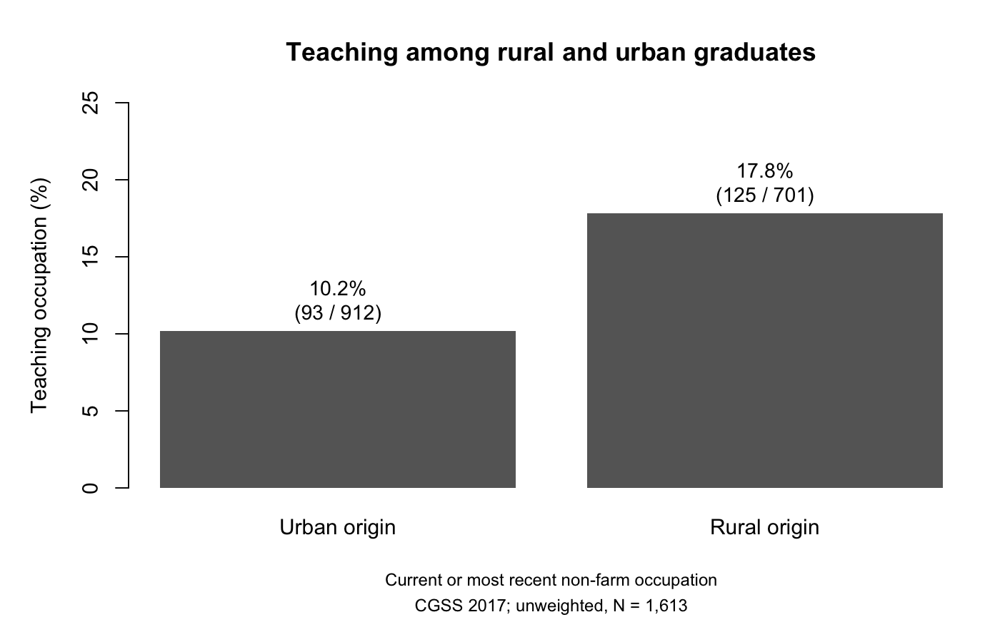

# Rural Origin, Teaching and Occupational Status among Graduates in China

Minghao Yang<br>
MA (Hons) Sociology, University of Edinburgh

In CGSS 2017, 13% of rural-origin respondents aged 25 to 60 completed their highest reported qualification at junior-college level or above. For urban-origin respondents the figure is 46.5%. Among 1,613 graduates with a current or previous occupation outside farming, does rural origin predict lower occupational status?

I expected it would. After adjusting for qualification tier, parental schooling, sex and age, rural graduates score 3.56 points higher on the ISEI occupational status scale (95% CI 1.8 to 5.4), about 0.2 standard deviations. The unadjusted gap is only 1.21 points. Adjustment raises the estimate in part because rural graduates hold lower qualifications and come from families with less schooling. I decompose this 2.35-point change following Gelbach (2016). The qualification tier accounts for roughly 42%.

One occupation stands out. Teaching is reported by 17.8% of rural-origin and 10.2% of urban-origin graduates, with an adjusted difference of 8.9 percentage points. Among current workers with positive income and a known employer sector, the adjusted gap favouring rural graduates is 6.1 ISEI points in the public sector. Outside the public sector the estimates are smaller and both intervals include zero. But within public-sector teaching the gap is −0.06 points (CI −1.95 to 1.83). The public-sector gap may have more to do with which jobs rural graduates enter than with a score difference among teachers.

Earnings tell a different story. Among 1,347 current workers with positive 2016 labour income, rural origin predicts slightly lower log income. The unweighted interval excludes zero, but with survey weights or province clustering it widens to include zero. I see higher occupational scores without an accompanying earnings advantage.



## About this project

This started as my undergraduate dissertation at Edinburgh on education tiers, rural origin and birth cohorts. The occupation decomposition, the sector analysis and the adjustment supplement were developed after submission.

Teaching is where I want to look next. Rural graduates are more likely to hold teaching jobs, which score highly on ISEI, and I want to know how they entered those jobs when so few rural-origin respondents in the wider sample had completed higher education.

## Methods

The analysis uses the 2017 Chinese General Social Survey (N = 12,582). The analytical sample is 1,613 respondents who completed their highest reported qualification at junior-college level or above and reported a current or previous occupation outside farming. Rural origin is village or township hukou registration at age 14.

The main specification is unweighted OLS with HC3 standard errors. I check against survey weights, province fixed effects and standard errors clustered across 28 interview provinces. Uncertainty in the adjustment decomposition comes from a province cluster bootstrap (1,999 draws). Teaching occupation is modelled with linear probability models. The sector models use interaction terms to separate the rural coefficient within each sector.

The main analysis uses syntax ISEI. The overview mapping and SIOPS provide alternative scores. The occupation allocation varies the reference score to examine how much of the fitted gap is assigned to teaching.

The scripts regenerate all tables and figures. `tools/check_results.R` checks consistency within and across the saved tables.

## Limitations and next steps

The data are one cross-section, so age, cohort and career stage cannot be separated. Selection into higher education could contribute to the positive rural coefficient, including selection on earlier attainment that these models do not measure. CGSS records the year and broad type of the highest qualification but not a complete qualification history or the timing of entry into teaching.

Possible routes include teacher training programmes that targeted rural students, recruitment through public exams, and qualifying while already in a post. The [discussion](docs/discussion.md) sets out what a study using linked records at county level would need.

## Reading the project

The [research note](docs/research-note.md) presents the argument. The [adjustment supplement](docs/origin-adjustment.md) explains why controlling for education and family background raises rather than lowers the rural coefficient. [Further results](docs/sensitivity.md) and [measurement notes](docs/measurement.md) cover the remaining tables and variable definitions. [Reproducibility](docs/reproducibility.md) describes how to run and check the analysis.

## Running the code

R 4.4.3 with package versions in [renv.lock](renv.lock). The CGSS 2017 data are not distributed here; see [data/raw](data/raw/README.md).

```sh
Rscript --vanilla -e 'source("renv/activate.R"); renv::restore(prompt = FALSE)'
Rscript --vanilla -e 'source("renv/activate.R"); source("R/04_run_analysis.R")'
```
