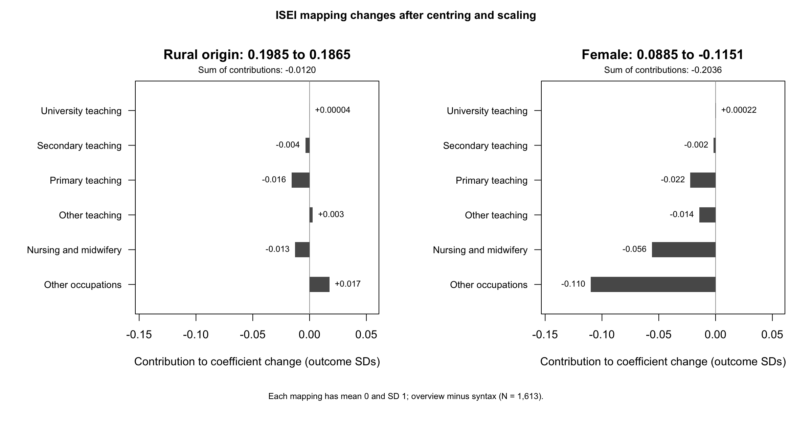
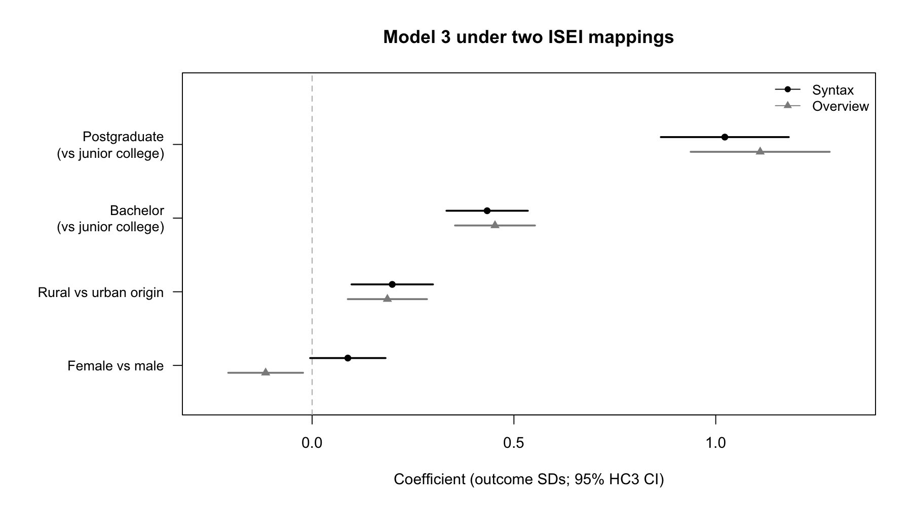
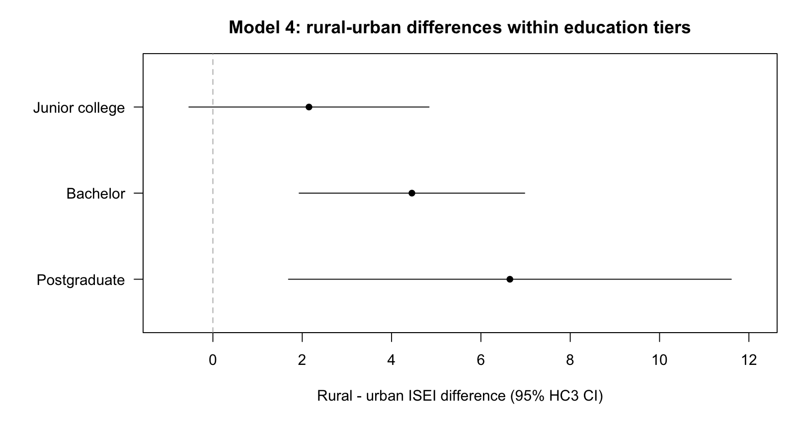

# Further results

## Teaching and qualifications

[Occupation shares](../output/tables/occupation_origin.csv) and differences adjusted for qualification tier, sex, age and parental education.

| Occupation | Rural share | Urban share | Adjusted rural difference, percentage points | 95% HC3 interval |
|---|---:|---:|---:|---|
| Teaching | 17.8% | 10.2% | 8.93 | 5.22 to 12.64 |
| Nursing and midwifery | 2.7% | 1.6% | 0.83 | -0.80 to 2.46 |

[Teaching models](../output/tables/teaching_checks.csv) with current-worker restrictions, province indicators and survey weights.

| Teaching model | N | Adjusted rural difference, percentage points | 95% HC3 interval | 95% province-clustered interval |
|---|---:|---:|---|---|
| Full sample | 1,613 | 8.93 | 5.22 to 12.64 | 4.80 to 13.07 |
| Current occupation only | 1,435 | 8.46 | 4.52 to 12.41 | 3.67 to 13.26 |
| Current occupation, plus province indicators | 1,435 | 7.07 | 3.18 to 10.97 | 2.22 to 11.92 |
| Same specification, weighted | 1,435 | 5.71 | 1.52 to 9.91 | 0.12 to 11.31 |

The broad codes `2300` and `2350` identify other teaching records without specifying their school level; these remain separate in the [teaching-code table](../output/tables/teaching_codes.csv).

Primary teaching ranks above software development in syntax ISEI and below it in overview. School teaching has high scores on all three scales.

| Occupation (ISCO) | ISEI syntax | ISEI overview | SIOPS |
|---|---:|---:|---:|
| Secondary teaching (2330) | 82.41 | 71 | 62.63 |
| Primary teaching (2341) | 76.49 | 61 | 57.00 |
| Software development (2512) | 74.66 | 70 | 51.00 |

Outside teaching, nursing and midwifery, the rural coefficient is 1.44 (95% HC3 interval −0.46 to 3.35). This refit excludes 252 respondents. Nursing is part of this exclusion because its scores differ sharply between mappings.

### Separating adult and regular qualifications

The [route models](../output/tables/teaching_routes.csv) use the 1,612 respondents whose category is known, first with three education tiers and then with five highest-qualification categories.

| Highest qualification in the teaching model | Adjusted rural difference, percentage points | 95% HC3 interval |
|---|---:|---|
| Junior college, bachelor, postgraduate | 8.94 | 5.23 to 12.64 |
| Adult and regular junior college; adult and regular bachelor; postgraduate | 8.98 | 5.26 to 12.71 |

With weights and province indicators among current workers, the estimates are 5.71 and 5.79 percentage points.

## Current employing organisations

The [organisation table](../output/tables/employer_context.csv) restricts attention to current non-farm workers in the main sample. Counts are unweighted; public institution means A59J=3. All current workers in each group enter the denominator.

| Origin and occupation | N | Public institution | Enterprise | Other or unreported | Institution share |
|---|---:|---:|---:|---:|---:|
| Rural teachers | 114 | 100 | 8 | 6 | 87.7% |
| Urban teachers | 84 | 65 | 9 | 10 | 77.4% |
| Rural non-teachers | 519 | 79 | 281 | 159 | 15.2% |
| Urban non-teachers | 718 | 114 | 447 | 157 | 15.9% |

## Income within provinces

The log-income models use positive annual labour income for 2016 among respondents with a current occupation in 2017. The [income-availability table](../output/tables/income_availability.csv) shows more missing exact amounts among urban respondents and similar zero-income shares.

| Origin | Current workers | Positive income | Zero income | No exact amount |
|---|---:|---:|---:|---:|
| Rural | 633 | 601 | 14 | 18 |
| Urban | 802 | 746 | 15 | 41 |

The [models below](../output/tables/income_comparison.csv) fit both ISEI and income on these positive-income respondents, with the Model 3 controls.

| Outcome | Specification | Rural coefficient | 95% HC3 interval | 95% province-clustered interval |
|---|---|---:|---|---|
| ISEI | Model 3 controls | 3.46 | 1.48 to 5.43 | 1.66 to 5.25 |
| ISEI | Plus province indicators | 3.28 | 1.22 to 5.33 | 1.51 to 5.05 |
| Log 2016 labour income | Model 3 controls | -0.103 | -0.187 to -0.019 | -0.223 to 0.016 |
| Log 2016 labour income | Plus province indicators | -0.064 | -0.141 to 0.013 | -0.138 to 0.011 |

The income coefficient moves towards zero after adding province indicators. Survey weighting gives estimates of −0.088 and −0.065, and the weighted HC3 and province-clustered intervals all include zero.

Adding weekly hours ([hours models](../output/tables/income_hours.csv), 1,318 respondents with valid hours) makes little difference.

## Rural contrasts within employer sectors

The [sector models](../output/tables/sector_contrasts.csv) use 1,338 positive-income current workers with a known sector ([definitions and counts](measurement.md#employer-sector)). Each row is a regression with the Model 3 controls, sector indicators and rural-origin-by-sector interactions. The first three numeric columns give rural-minus-urban differences and 95% HC3 intervals within each sector.

| Outcome and specification | Public | State enterprise | Non-state enterprise and other | Interaction test, HC3 p | Province-clustered p |
|---|---:|---:|---:|---:|---:|
| ISEI, Model 3 controls plus sector | 6.08 (3.42 to 8.73) | 1.50 (−3.55 to 6.54) | 0.01 (−2.70 to 2.72) | .005 | .052 |
| ISEI, plus province indicators | 6.31 (3.46 to 9.15) | 1.88 (−3.17 to 6.94) | 0.06 (−2.68 to 2.80) | .005 | .045 |
| ISEI, plus province indicators, weighted | 6.71 (3.47 to 9.94) | 0.57 (−5.65 to 6.79) | 0.42 (−2.62 to 3.45) | .010 | .026 |
| Log income, Model 3 controls plus sector | −0.039 (−0.144 to 0.066) | −0.112 (−0.315 to 0.090) | −0.097 (−0.225 to 0.031) | .703 | .651 |
| Log income, plus province indicators | 0.005 (−0.086 to 0.096) | −0.145 (−0.335 to 0.044) | −0.080 (−0.199 to 0.039) | .261 | .218 |
| Log income, plus province indicators, weighted | 0.013 (−0.094 to 0.119) | −0.129 (−0.329 to 0.071) | −0.096 (−0.228 to 0.036) | .280 | .236 |

With province clustering, the public-sector ISEI intervals are 3.79–8.37, 3.68–8.93 and 3.75–9.67. In the baseline HC3 model, the non-state-and-other gap is 6.07 points below the public gap (interaction −6.07, interval −9.76 to −2.38). For state enterprises, which include only 63 rural-origin workers, the interaction is −4.58 (−10.22 to 1.06).

The income interaction tests are all nonsignificant. In the baseline [model](../output/tables/sector_coefficients.csv), urban-origin enterprise workers score 11.1 and 9.2 ISEI points below urban-origin public workers.

### Teaching and income on the same respondents

The teaching comparison outlined in the [discussion](discussion.md#the-income-comparison-within-teaching) is fitted on all 1,347 positive-income respondents and, without province indicators, on the 463 public-sector respondents with 98 rural and 60 urban teachers in the public sector, 13 and 17 outside it ([counts](../output/tables/sector_teaching.csv)).

| Sample and outcome | Specification | Rural difference, other occupations | Rural difference, teaching | Interaction test, HC3 p |
|---|---|---:|---:|---:|
| All 1,347, log income | Model 3 controls plus teaching | −0.066 (−0.160 to 0.027) | −0.153 (−0.309 to 0.002) | .331 |
| All 1,347, log income | Plus province indicators | −0.048 (−0.133 to 0.037) | −0.112 (−0.255 to 0.031) | .434 |
| All 1,347, ISEI | Model 3 controls plus teaching | 1.35 (−0.68 to 3.38) | 2.31 (0.23 to 4.39) | .501 |
| All 1,347, ISEI | Plus province indicators | 1.49 (−0.58 to 3.56) | 1.90 (−0.72 to 4.52) | .802 |
| Public sector, 463, log income | Model 3 controls plus teaching | −0.043 (−0.186 to 0.100) | −0.110 (−0.245 to 0.025) | .489 |
| Public sector, 463, ISEI | Model 3 controls plus teaching | 2.80 (−0.37 to 5.97) | −0.06 (−1.95 to 1.83) | .114 |

The income estimates are more negative among teachers, with nonsignificant teacher-by-origin interactions. Within public employment, the rural ISEI estimate among teachers is essentially zero in both weighted and unweighted models. Weighting moves the public-teacher income estimate from −0.110 to −0.035; the weighted fits are in the same tables.

## The gender sign flip

The female coefficient flips from +1.59 under syntax ISEI to −1.63 under overview, with the same respondents and controls.

Nursing professionals lose particularly many points in the switch, from 68.70 to 42, and every nurse and midwife in this sample is a woman. Women also make up 82.1% of primary teachers. I traced the change by replacing scores for one occupation group at a time and refitting Model 3, after putting each mapping in standard-deviation units. [Raw-point swaps](../output/tables/mapping_contributions.csv) are also saved.

The broad other-occupations group makes the largest standardised contribution to the female coefficient change. Nursing and primary teaching also pull the estimate down. Outside teaching, nursing and midwifery, both mappings give a negative female coefficient.

The [rural coefficients](../output/tables/scale_comparison.csv) are much closer when expressed in standard deviations.

| Scale | Outcome SD | Rural coefficient | Coefficient in SD units | 95% HC3 interval in SD units |
|---|---:|---:|---:|---|
| ISEI syntax | 17.93 | 3.56 | 0.199 | 0.098 to 0.299 |
| ISEI overview | 14.15 | 2.64 | 0.186 | 0.088 to 0.285 |
| SIOPS prestige | 12.04 | 2.29 | 0.190 | 0.090 to 0.290 |

## When teachers got their qualifications

For study during employment, I compare the year of the highest qualification with reported working years. The [timing table](../output/tables/qualification_timing.csv) starts with 1,369 current workers whose dates pass the [screening rules](measurement.md#occupations-and-qualification-dates). Rural graduates are more often teachers in both qualification-route groups.

| Qualification route | Rural teachers / rural graduates | Urban teachers / urban graduates |
|---|---:|---:|
| Adult junior college or bachelor | 39/206 (18.9%) | 23/188 (12.2%) |
| Regular junior college or bachelor, plus postgraduate | 72/398 (18.1%) | 57/577 (9.9%) |

Among the regular-route and postgraduate teachers, 25 of 129 obtained their highest qualification more than a year after estimated entry into the current workplace. Cumulative working years place 33 of the 129 after estimated work entry.

For the adult-route teachers, both duration questions are available. One respondent reports fewer cumulative working years than years with the current employer.

| Basis for estimated work entry | Rural: qualification later | Urban: qualification later | Fisher two-sided p |
|---|---:|---:|---:|
| Current employer (A59m) | 25/39 | 11/23 | .288 |
| Cumulative working years (A59c) | 31/39 | 12/23 | .044 |
| Cumulative years, consistent duration records | 31/39 | 12/22 | .077 |

Removing that one inconsistent response moves Fisher's p value from .044 to .077.

## Other checks

Model specifications, coding levels and interactions

### Mean ISEI by education and origin

Unadjusted means by qualification tier.

| Education | Urban-origin N | Mean ISEI | Rural-origin N | Mean ISEI |
|---|---:|---:|---:|---:|
| Junior college | 358 | 51.64 | 338 | 51.97 |
| Bachelor | 476 | 57.38 | 322 | 60.62 |
| Postgraduate | 78 | 67.06 | 41 | 72.87 |

### Model 3 under different choices

ISEI coefficients, with junior college as the reference category. The A27F row is Model 7. Overview results use the original-table correction described in [measurement](measurement.md#occupational-status).

| Model 3 specification | N | Bachelor | Postgraduate | Rural origin | Female | Parental education |
|---|---:|---:|---:|---:|---:|---:|
| Main (syntax ISEI) | 1,613 | 7.78 | 18.34 | 3.56 | 1.59 | 0.29 |
| Overview ISEI | 1,613 | 6.41 | 15.71 | 2.64 | -1.63 | 0.22 |
| Current occupation only | 1,435 | 7.16 | 17.80 | 3.12 | 1.82 | 0.22 |
| Regular HE plus postgraduate | 1,121 | 7.94 | 17.73 | 3.22 | 0.14 | 0.22 |
| Exclude parental Other | 1,602 | 7.87 | 18.37 | 3.64 | 1.59 | 0.31 |
| Weighted | 1,613 | 8.35 | 18.93 | 3.21 | 1.32 | 0.41 |
| A27F origin (Model 7) | 1,613 | 7.75 | 18.29 | 3.65 | 1.60 | 0.29 |
| Outside teaching/nursing/midwifery | 1,361 | 6.86 | 17.30 | 1.44 | -1.68 | 0.38 |
| Same occupations, overview ISEI | 1,361 | 5.67 | 14.80 | 1.52 | -2.98 | 0.26 |

Rural coefficients and 95% province-clustered intervals.

| Sample | Weights | Model 3 controls | Plus province indicators |
|---|---|---|---|
| Full (N=1,613) | Unweighted | 3.56 [1.65, 5.47] | 3.36 [1.50, 5.22] |
| Full (N=1,613) | Survey weights | 3.21 [0.97, 5.46] | 2.81 [0.64, 4.98] |
| Current occupation (N=1,435) | Unweighted | 3.12 [1.19, 5.05] | 2.93 [1.11, 4.75] |
| Current occupation (N=1,435) | Survey weights | 2.82 [0.49, 5.16] | 2.48 [0.35, 4.60] |

HC3 intervals are in the [province table](../output/tables/isei_province.csv).

Adding origin to Model 2 raises the parental-education coefficient from 0.13 to 0.29. This looks like suppression. Rural graduates have higher ISEI scores despite lower parental schooling (8.21 years, against 10.87). The [adjustment supplement](origin-adjustment.md) keeps rural origin in every model and examines the changes as the other controls enter.

Separating adult and regular qualifications leaves the rural coefficient at 3.76 (N = 1,612). Relative to regular junior college, the bachelor estimates are 4.82 for adult and 8.05 for regular degrees. The main education tiers pool these two routes.

The unit-group check excludes the 227 respondents with broader occupational codes. The [coding table](../output/tables/occupation_coding.csv) gives their distribution by origin.

Village/township coding and the restriction to unit-group occupation codes.

| Check | Result |
|---|---|
| Townships separated from villages | Township coefficient 3.24; village coefficient 3.62, each relative to urban origin |
| Unit-group records only, syntax ISEI (N=1,386) | Rural coefficient 3.74; 95% HC3 interval 1.84 to 5.63 |
| Same records, overview ISEI | Rural coefficient 2.65; 95% HC3 interval 1.18 to 4.12 |

Sources: [model_coefficients.csv](../output/tables/model_coefficients.csv), [province_cluster.csv](../output/tables/province_cluster.csv).

### Interactions

[Table 2 in the research note](research-note.md#teaching-and-employer-sector) places the teaching-share gaps beside the Model 4 ISEI estimates.

In Model 6, the earliest-cohort postgraduate cell has two respondents, with almost zero residuals; the largest observed leverage is 0.50. The postgraduate main-effect SE is 1.81 under HC3 and 12.17 under the classical calculation. See [model_diagnostics.csv](../output/tables/model_diagnostics.csv).

I do not use this interaction to explain the cohort pattern. The joint test changes sharply with the scoring method, sample and standard-error calculation.

| Model 6 against Model 5 | p |
|---|---:|
| Syntax ISEI, full sample, classical test | .544 |
| Syntax ISEI, full sample, HC3 | .012 |
| Overview ISEI, full sample, HC3 | .569 |
| Current occupations only, HC3 | .129 |

